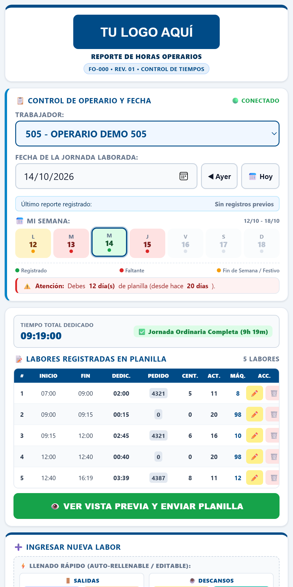
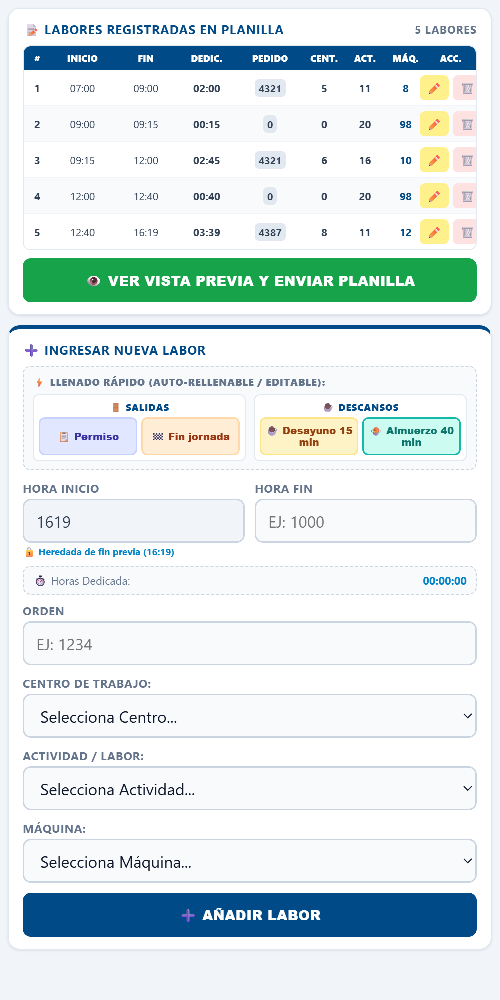
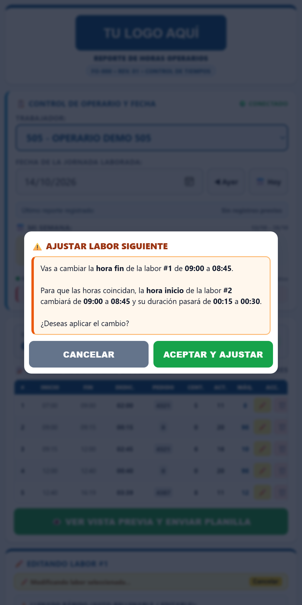
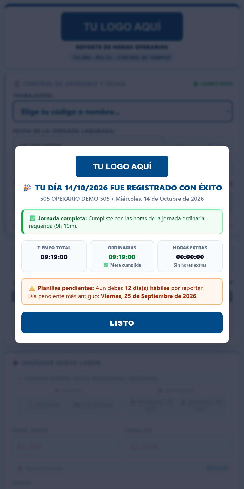
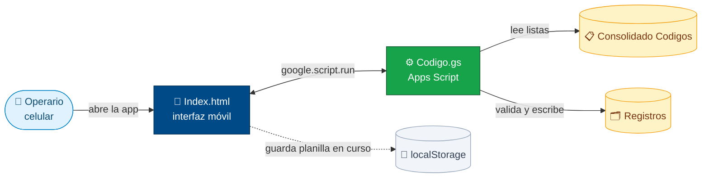
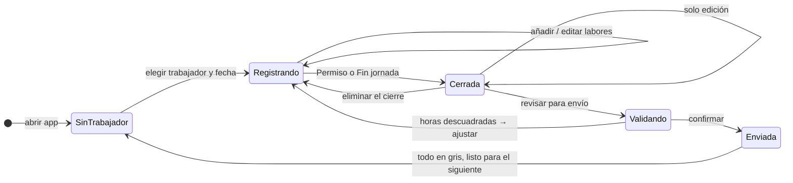

<div align="center">

# ⏱️ Reporte de Horas de Operarios

### Registro de jornadas en planta, labor por labor, desde el celular y directo a Google Sheets

[](https://developers.google.com/apps-script)
[](https://workspace.google.com/products/sheets/)
[](#)
[](#)


[](LICENSE)

<br>

<table>
  <tr>
    <td align="center"><br><sub><b>📅 Semana y planilla</b></sub></td>
    <td align="center"><br><sub><b>⚡ Accesos rápidos</b></sub></td>
    <td align="center"><br><sub><b>🔗 Ajuste en cadena</b></sub></td>
    <td align="center"><br><sub><b>🎉 Resumen del envío</b></sub></td>
  </tr>
</table>

</div>

> [!NOTE]
> Esta es una **versión de demostración**: todos los trabajadores, centros, máquinas, órdenes y logos son ficticios. El código está listo para conectarse a tu propia hoja de cálculo.

---

## 📑 Contenido

- [✨ Características](#-características)
- [🏗️ Cómo funciona](#️-cómo-funciona)
- [🚀 Instalación en 5 pasos](#-instalación-en-5-pasos)
- [📊 Estructura de la hoja](#-estructura-de-la-hoja)
- [🧪 Pruebas](#-pruebas)
- [🎛️ Personalización](#️-personalización)
- [🔒 Seguridad y calidad de datos](#-seguridad-y-calidad-de-datos)
- [📁 Estructura del repositorio](#-estructura-del-repositorio)
- [📄 Licencia](#-licencia)

---

## ✨ Características

<table>
<tr>
<td width="50%" valign="top">

### 📋 Listas vivas desde Sheets
Trabajadores, centros, actividades, máquinas y festivos se leen de la hoja. ¿Llegó un operario nuevo? **Agrega una fila** y aparece en la app, sin tocar código ni volver a desplegar.

</td>
<td width="50%" valign="top">

### 🔗 Horas siempre en cadena
Cada labor empieza donde termina la anterior. Si editas una hora fin, la app **te avisa y ajusta la siguiente**. Antes de enviar, un validador detecta cualquier descuadre.

</td>
</tr>
<tr>
<td valign="top">

### ⚡ Accesos rápidos
**Salidas** (🗂️ Permiso, 🏁 Fin jornada) y **Descansos** (☕ Desayuno 15 min, 🍲 Almuerzo 40 min) se llenan con un toque y siguen siendo editables.

</td>
<td valign="top">

### 🔒 Jornada cerrada
Tras un Permiso o un Fin de jornada **nada se mueve**: trabajador, fecha y semana quedan bloqueados. Solo se pueden editar las labores existentes.

</td>
</tr>
<tr>
<td valign="top">

### 📅 Control semanal y pendientes
Semáforo de la semana (registrado, faltante, fin de semana o festivo) y conteo de **días hábiles pendientes**, que excluye fines de semana, festivos y el día de hoy.

</td>
<td valign="top">

### ⏰ Reglas de jornada
Tope de **16 h** por labor y por día, **meta ordinaria** configurable con cálculo de **horas extras**, y soporte para turnos que **cruzan la medianoche** 🌙.

</td>
</tr>
<tr>
<td valign="top">

### 📶 Funciona con mala señal
La planilla en curso y la última copia de las listas se guardan en el dispositivo, así nada se pierde si se cae la conexión.

</td>
<td valign="top">

### 🎨 Hecha para el celular
Botones grandes, teclado numérico para horas militares (`730` → `07:30`), vista previa tipo formato impreso y resumen final con horas ordinarias y extras.

</td>
</tr>
</table>

---

## 🏗️ Cómo funciona



<details>
<summary><b>🔄 Ciclo de vida de una jornada</b> (clic para ver)</summary>

<br>



</details>

---

## 🚀 Instalación en 5 pasos

| Paso | Qué hacer |
|:---:|---|
| **1** | En tu hoja de cálculo abre **Extensiones → Apps Script**. |
| **2** | Crea `Codigo.gs` e `Index.html` (el HTML debe llamarse exactamente **`Index`**) y pega el contenido de este repo. |
| **3** | Si el script **no** está vinculado a la hoja, reemplaza `TU_SPREADSHEET_ID` en `CONFIG.SPREADSHEET_ID`. |
| **4** | En **Configuración del proyecto**, ajusta la zona horaria (por defecto `America/Bogota`). |
| **5** | Ve a **Implementar → Nueva implementación → Aplicación web** y comparte el enlace con los operarios. 🎉 |

> [!TIP]
> **Pon tu logo:** en `Index.html` cambia el `src` de la imagen con clase `header-logo-img` (por una URL o `data:image/png;base64,...`). La vista previa y el resumen final lo reutilizan automáticamente.

> [!WARNING]
> En **Implementar → Administrar implementaciones → Quién tiene acceso**, recuerda que la página carga la lista de trabajadores. Si eliges *"Cualquier usuario"*, no publiques el enlace en sitios abiertos.

---

## 📊 Estructura de la hoja

<details open>
<summary><b>📋 <code>Consolidado Codigos</code></b>: alimenta las listas desplegables</summary>

<br>

Las columnas se reconocen **por su cabecera**, en cualquier orden:

| Trabajadores | Centro de trabajo | Actividad | Maquina | Festivos *(opcional)* |
|---|---|---|---|---|
| `501 APELLIDO NOMBRE` | `0 - OTROS` | `20 - DESCANSO` | `0 - NINGUNA` | `2026-12-25` |
| `502 APELLIDO NOMBRE` | `1 - CENTRO 01` | `23 - PERMISO` | `98 - OTROS` | `2027-01-01` |

- 👷 Trabajador: `CODIGO NOMBRE COMPLETO`. Centros, actividades y máquinas: `CODIGO - NOMBRE`.
- ⚡ Los accesos rápidos usan **Centro `0`**, **Actividad `20`** (descanso) y **`23`** (permiso), y la máquina **`98 - OTROS`** (`CONFIG.MAQUINA_PAUSA`). Si la hoja no la tiene, la app la agrega.

</details>

<details>
<summary><b>🗂️ <code>Registros</code></b>: donde se guardan las planillas (se crea sola)</summary>

<br>

| Día de registro | Trabajador | Fecha laborada | N° Labor | Hora Inicio | Hora Fin | Horas Dedicada | N° Orden | Centro | Actividad | Máquina |
|---|---|---|---|---|---|---|---|---|---|---|
| `2026-10-13 08:00:00` | `501 …` | `2026-10-12` | `1` | `07:00:00` | `09:00:00` | `02:00:00` | `4321` | `5 - …` | `11 - …` | `8 - …` |

</details>

---

## 🧪 Pruebas

Sin Google, sin Node: solo **Python** y un **navegador**. El repo trae un simulador de los servicios de Apps Script (`SpreadsheetApp`, `LockService`, `Utilities`, `HtmlService`…) para ejecutar la app completa en local.

```bash
cd pruebas
python setup.py
python -m http.server 8765
```

| Suite | URL | Qué cubre |
|---|---|---|
| ⚙️ **Backend** | `http://127.0.0.1:8765/backend_tests.html` | **24** pruebas: listas, días pendientes, guardado, duplicados, bloqueo concurrente, horas en cadena, turnos nocturnos, casos límite |
| 📱 **Frontend** | `http://127.0.0.1:8765/frontend_tests.html` | **23** ensayos de uso real: flujo completo de envío, edición, accesos rápidos, bloqueos, validador, modo sin conexión, XSS |

---

## 🎛️ Personalización

| ¿Qué quieres cambiar? | ¿Dónde? |
|---|---|
| ⏰ Tope de horas, meta ordinaria, ventana de pendientes | `CONFIG` en `Codigo.gs` · `MINUTOS_JORNADA_ORDINARIA` y `LIMITE_MAXIMO_MINUTOS` en `Index.html` |
| 🎉 Festivos | `LISTAS_DEFAULT.festivos` en `Codigo.gs`, o la columna **Festivos** de la hoja |
| 🏭 Máquina de los accesos rápidos | `CONFIG.MAQUINA_PAUSA` en `Codigo.gs` y `MAQUINA_PAUSA` en `Index.html` |
| 🎨 Colores | Variables CSS en `:root` al inicio de `Index.html` |
| 🧾 Código y revisión del formato | Textos `FO-000` y `REV. 01` en `Index.html` |

---

## 🔒 Seguridad y calidad de datos

| | Protección |
|:---:|---|
| 🔐 | **`LockService`**: dos envíos simultáneos nunca se pisan en la hoja. |
| 🚫 | **Anti-duplicados**: una jornada (trabajador + fecha) no se puede guardar dos veces. |
| 🔗 | **Horas en cadena**: el servidor rechaza planillas con horas que no coinciden. |
| 🧮 | **Cálculo en servidor**: las horas dedicadas se recalculan, sin confiar en el cliente. |
| 📆 | **Fechas**: no se aceptan jornadas futuras ni lotes que mezclen trabajadores o fechas. |
| 🛡️ | **Escape HTML**: los textos de la hoja nunca se ejecutan como código. |

---

## 📁 Estructura del repositorio

```
📦 reporte-horas-apps-script
 ┣ 📜 Codigo.gs            → Backend: doGet, listas, estado del trabajador, guardado y validaciones
 ┣ 🌐 Index.html           → Frontend: interfaz móvil completa (plantilla HtmlService)
 ┣ 📄 LICENSE              → Licencia MIT
 ┣ 🖼️ docs/                → Capturas de la demo
 ┗ 🧪 pruebas/
    ┣ gas_mock.js          → Simulador de servicios de Apps Script
    ┣ datos.js             → Datos ficticios de la hoja
    ┣ bridge.js            → Simula google.script.run y la plantilla de doGet
    ┣ backend_tests.html   → 24 pruebas del backend
    ┣ frontend_tests.html  → 23 ensayos de la app
    ┗ setup.py             → Genera las páginas de prueba
```

---

## 📄 Licencia

Distribuido bajo la **licencia MIT**: puedes usarlo, copiarlo, modificarlo y adaptarlo a tu empresa libremente, siempre que conserves el aviso de autoría. Detalles en [`LICENSE`](LICENSE).

---

<div align="center">

Hecho con ☕ y 🔧 para que el reporte de horas deje de ser un dolor de cabeza.

</div>
