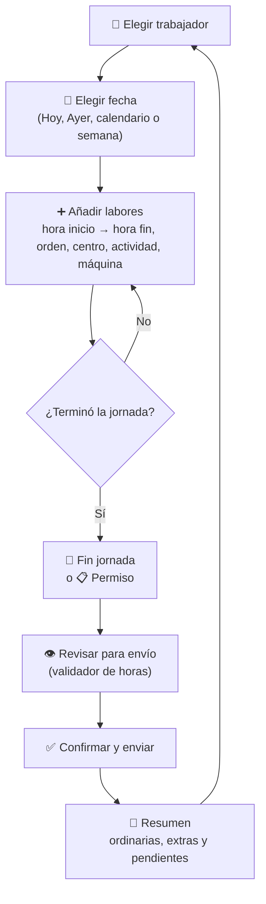
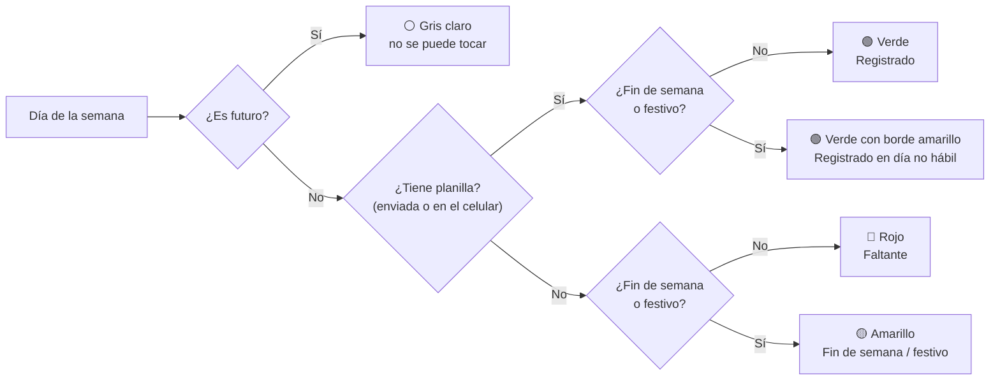

# 📘 Manual de uso

### Reporte de Horas de Operarios: pantalla por pantalla

[⬅️ Volver al README](../README.md)

---

## 📑 Contenido

1. [Recorrido rápido](#1--recorrido-rápido)
2. [Panel 1: Operario y fecha](#2--panel-1-operario-y-fecha)
3. [Cómo funcionan las fechas](#3--cómo-funcionan-las-fechas)
4. [Panel 2: Planilla del día](#4--panel-2-planilla-del-día)
5. [Panel 3: Ingresar labor](#5--panel-3-ingresar-labor)
6. [Accesos rápidos: Salidas y Descansos](#6--accesos-rápidos-salidas-y-descansos)
7. [Editar, eliminar y horas en cadena](#7--editar-eliminar-y-horas-en-cadena)
8. [Jornada cerrada](#8--jornada-cerrada)
9. [Vista previa y envío](#9--vista-previa-y-envío)
10. [Resumen después de enviar](#10--resumen-después-de-enviar)
11. [Sin conexión](#11--sin-conexión)
12. [Qué se guarda en la hoja](#12--qué-se-guarda-en-la-hoja)
13. [Todos los parámetros](#13--todos-los-parámetros)
14. [Mensajes de error y qué hacer](#14--mensajes-de-error-y-qué-hacer)

---

## 1. 🧭 Recorrido rápido

La app tiene **tres paneles** de arriba hacia abajo y **tres ventanas emergentes** (vista previa, avisos y resumen).

---

## 2. 👷 Panel 1: Operario y fecha

| Elemento | Qué hace |
|---|---|
| **Indicador de conexión** | 🟢 *Conectado* · ⏳ *Sincronizando…* · ⚠️ *Fuera de línea*. |
| **Trabajador** | Lista que viene de la hoja `Consolidado Codigos`. Se muestra como `501 - NOMBRE`. La app recuerda el último elegido en el dispositivo. |
| **Fecha de la jornada** | Calendario + botones **◀ Ayer** y **📅 Hoy**. No permite fechas futuras. |
| **Último reporte registrado** | La fecha más reciente que este trabajador tiene guardada en la hoja. |
| **Mi semana** | Los 7 días (lunes a domingo) de la semana de la fecha elegida, con colores. Tocar un día lo selecciona. |
| **Aviso de pendientes** | Cuántos días hábiles le faltan por reportar (ver [sección 3](#3--cómo-funcionan-las-fechas)). |

> Al cambiar de trabajador, el formulario se limpia y se consulta su historial en la hoja.

 

---

## 3. 📅 Cómo funcionan las fechas

### 3.1 Colores de "Mi semana"

- El día elegido se resalta con **borde azul**.
- Un día cuenta como *registrado* si ya está en la hoja **o** si tiene labores guardadas en el celular sin enviar.
- Sin trabajador elegido (por ejemplo, justo después de enviar), **toda la semana se ve gris**.

### 3.2 Días pendientes ("Debes N días")

Un día es **pendiente** cuando cumple **todo** esto:

| Regla | Detalle |
|---|---|
| 📆 Está en la ventana | Entre hace **20 días** y **ayer** (`DIAS_VENTANA_PENDIENTES`). |
| 🗓️ Es hábil | Lunes a viernes. |
| 🎉 No es festivo | Festivos de `LISTAS_DEFAULT.festivos` + columna *Festivos* de la hoja. |
| ⏳ No es hoy | El día de hoy nunca cuenta como deuda: la jornada aún no termina. |
| 📭 No tiene planilla | Ni en la hoja ni en el celular. |

- El aviso es **naranja** con 1 a 5 días pendientes y **rojo** con más de 5.
- "Desde hace *N* días" cuenta desde el día pendiente más antiguo.
- El servidor y la pantalla usan **exactamente la misma regla**, así que el número del aviso y el del resumen final coinciden.

### 3.3 Reglas de fecha al guardar

| Situación | Qué pasa |
|---|---|
| Fecha futura | No se puede elegir y el servidor la rechaza. |
| Fecha **ya enviada** a la hoja | Aparece 🔒 *"Jornada ya enviada a la base de datos"* y el formulario se bloquea. |
| Cambiar de fecha mientras se edita una labor | La edición se cancela, para no mezclar jornadas. |
| La app queda abierta después de medianoche | El límite de "hoy" se actualiza solo al cambiar la fecha. |

### 3.4 Formato de fechas aceptado en la hoja

Para leer la columna *Fecha laborada* de `Registros` y la columna *Festivos*, la app acepta:
- Celdas de tipo **fecha** de Google Sheets.
- Texto `aaaa-mm-dd` o `aaaa/mm/dd` (ej. `2026-12-25`).
- Texto `dd-mm-aaaa` o `dd/mm/aaaa` (ej. `25/12/2026`).

> La zona horaria del proyecto (`America/Bogota` por defecto) define qué es "hoy" y qué es "ayer".

---

## 4. 📝 Panel 2: Planilla del día

**Resumen de tiempo** (arriba):

| Estado | Lo que muestra |
|---|---|
| Sin labores | `Meta Ordinaria: 09:19:00` |
| Por debajo de la meta | `Faltan Xh Ym para ordinaria` |
| Exactamente la meta | `✅ Jornada Ordinaria Completa (9h 19m)` |
| Por encima | `⭐ Horas Extras: +Xh Ym` |

**Tabla de labores:**

| Columna | Significado |
|---|---|
| **#** | Número de labor del día (se renumera al eliminar). |
| **Inicio / Fin** | Horas en formato `HH:MM`. 🌙 = cruza la medianoche. 🏁 *Fin* = salida. |
| **Dedic.** | Duración de la labor. |
| **Pedido** | Número de orden (0 = sin orden). |
| **Cent. / Act. / Máq.** | Solo el **código**, para que quepa en el celular. En computador, pasa el mouse encima para ver el nombre completo. |
| **Acc.** | ✏️ Editar · 🗑️ Eliminar. |

Si una **hora inicio no coincide** con la hora fin de la labor anterior, la celda se pinta en **rojo con ⚠️**.

 

---

## 5. ➕ Panel 3: Ingresar labor

| Campo | Cómo se llena | Reglas |
|---|---|---|
| **Hora inicio** | Hora militar sin dos puntos: `730`, `0730`, `1415` | 3 o 4 dígitos, horas 00-23, minutos 00-59. **Desde la segunda labor se hereda sola** de la hora fin anterior y queda bloqueada 🔒. |
| **Hora fin** | Igual: `1000`, `1619` | Distinta de la hora inicio. Si es menor que la de inicio, se entiende que **cruza la medianoche** (turno nocturno 🌙). |
| **Horas dedicada** | Se calcula sola mientras escribes | Muestra error si pasa de **16 h** o si la hora inicio no coincide con la fin previa. |
| **Orden** | Número de pedido | Hasta 4 dígitos. Vacío = `0`. |
| **Centro de trabajo** | Lista de la hoja | Obligatorio. |
| **Actividad / Labor** | Lista de la hoja | Obligatoria. |
| **Máquina** | Lista de la hoja | Obligatoria. Siempre incluye `0 - NINGUNA` y `98 - OTROS`. |

**Topes de tiempo:**
- Una labor no puede durar más de **16 horas**.
- La suma del día tampoco puede pasar de **16 horas**.

---

## 6. ⚡ Accesos rápidos: Salidas y Descansos

| Botón | Grupo | Hora fin | Orden | Centro | Actividad | Máquina | ¿Cierra la jornada? |
|---|---|---|---|---|---|---|:---:|
| 📋 **Permiso** | 🚪 Salidas | La digitas tú | 0 | 0 | **23** (permiso) | 98 - OTROS | ✅ Sí |
| 🏁 **Fin jornada** | 🚪 Salidas | *(sin hora fin)* | 0 | 0 | 20 | 98 - OTROS | ✅ Sí |
| ☕ **Desayuno** | ☕ Descansos | Inicio **+15 min** | 0 | 0 | **20** (descanso) | 98 - OTROS | ❌ No |
| 🍲 **Almuerzo** | ☕ Descansos | Inicio **+40 min** | 0 | 0 | **20** (descanso) | 98 - OTROS | ❌ No |

- Los botones **solo llenan el formulario**: puedes cambiar cualquier dato antes de pulsar *Añadir labor*.
- **Fin jornada** registra la **hora de salida** (su hora inicio) y cambia el botón principal por **👁️ Revisar para envío**.
- Los códigos (`0`, `20`, `23`, `98 - OTROS`) se buscan en las listas de la hoja. Ver [parámetros](#13--todos-los-parámetros).

---

## 7. ✏️ Editar, eliminar y horas en cadena

**Regla de oro:** cada labor **empieza exactamente cuando termina la anterior**.

- **Editar (✏️):** carga la labor en el formulario y muestra *"Modificando labor seleccionada…"*. Puedes cancelar con **Cancelar**.
- **Cambiar la hora fin** de una labor que tiene otra después hace que la app **avise** antes de guardar:
  > *Vas a cambiar la hora fin de la labor #1 de 09:00 a 08:45. Para que las horas coincidan, la hora inicio de la labor #2 cambiará de 09:00 a 08:45 y su duración pasará de 00:15 a 00:30.*
  - **Aceptar y ajustar**: guarda las dos labores cuadradas.
  - **Cancelar**: no cambia nada.
- Si la nueva hora fin **llega o pasa** la hora fin de la labor siguiente, la app **no lo permite** y pide editar o eliminar primero esa labor.
- **Eliminar (🗑️):** pide confirmación y renumera las labores.

 

---

## 8. 🔒 Jornada cerrada

Cuando la planilla del día tiene un **📋 Permiso** o un **🏁 Fin jornada**:

| Queda bloqueado 🔒 | Sigue disponible ✅ |
|---|---|
| Selector de trabajador | ✏️ Editar labores existentes |
| Fecha, botones Ayer/Hoy y días de la semana | 🗑️ Eliminar labores |
| Formulario y botones rápidos | 👁️ Revisar para envío / Ver vista previa |
| Agregar labores nuevas | |

- Al editar una labor, el formulario se habilita **solo para esa labor** y se vuelve a bloquear al guardar.
- Si eliminas el Permiso o el Fin jornada, la jornada **se desbloquea**.

---

## 9. 👁️ Vista previa y envío

1. Pulsa **👁️ Ver vista previa y enviar planilla** (o **Revisar para envío**).
2. **Validador de horas:** si alguna labor no inicia donde termina la anterior, aparece *"Horas que no coinciden"* con la lista de diferencias y la opción **Ajustar horas**, que las corrige automáticamente. Si el ajuste dejaría una labor inválida, no cambia nada y te indica cuál corregir a mano.
3. Se abre la **vista previa del formato FO-000**: fecha, día de la semana, trabajador, código y la tabla (#, hora, pedido, centro, código de actividad, máquina), con el total de horas y el desglose de ordinarias y extras.
4. **✏️ Modificar** vuelve a la planilla. **✅ Confirmar y enviar** la guarda en la hoja.

---

## 10. 🎉 Resumen después de enviar

| Parte | Qué muestra |
|---|---|
| **Título** | `Tu día DD/MM/AAAA fue registrado con éxito`. |
| **Alerta de meta** | ✅ *Jornada completa*, ⚠️ *No cumpliste con las horas mínimas* (con cuánto faltó) o 📋 *Jornada reducida justificada con Permiso*. |
| **Tiempo total** | Suma de todas las labores. |
| **Ordinarias** | Hasta la meta (9 h 19 min por defecto). |
| **Horas extras** | Lo que pasa de la meta. |
| **Pendientes** | ✅ *Estás al día*, o cuántos días hábiles faltan y cuál es el más antiguo. |

Al pulsar **Listo**, la app queda **en gris** y limpia, lista para el siguiente operario.

 

---

## 11. 📶 Sin conexión

| Qué | Dónde se guarda | Para qué |
|---|---|---|
| Labores aún no enviadas | Celular (`localStorage`) | Si se cierra la app o se cae la señal, la planilla sigue ahí. |
| Listas de la hoja | Celular (copia en caché) | Se puede seguir llenando la planilla sin conexión. |
| Último trabajador y fecha | Celular | Al reabrir, continúa donde quedó. |

> Para **enviar** sí se necesita conexión. Si falla, la app muestra el error y la planilla **no se borra**.

---

## 12. 🗂️ Qué se guarda en la hoja

Cada labor es **una fila** en `Registros`:

| Col. | Campo | Ejemplo | Nota |
|:---:|---|---|---|
| A | Día de registro | `2026-10-14 16:25:03` | Momento del envío. |
| B | Trabajador | `501 OPERARIO DEMO 501` | |
| C | Fecha - laborada | `2026-10-13` | |
| D | N° Labor | `1` | |
| E | Hora Inicio | `07:00:00` | Texto. |
| F | Hora Fin | `09:00:00` | Vacía en la fila de Fin jornada. |
| G | Horas Dedicada | `02:00:00` | **Recalculada por el servidor.** Vacía en Fin jornada. |
| H | N° Orden | `4321` | |
| I | Centro de Trabajo | `5 - CENTRO 5` | |
| J | Actividad / Labor | `11 - FABRICACIÓN` | |
| K | Máquina | `8 - MAQUINA 08` | |

**Validaciones del servidor** (aunque alguien salte las del celular):
- ✅ Horas militares válidas, también en la fila de cierre.
- ✅ Cada labor inicia donde termina la anterior.
- ✅ Máximo 16 h por labor y por jornada.
- ✅ Sin fechas futuras.
- ✅ Un solo trabajador y una sola fecha por envío.
- ✅ La jornada no existe ya en la hoja (anti-duplicados).
- ✅ Bloqueo (`LockService`) para que dos envíos simultáneos no se pisen.

---

## 13. 🎛️ Todos los parámetros

### 13.1 Backend: `CONFIG` en `Codigo.gs`

| Parámetro | Valor por defecto | Qué controla |
|---|---|---|
| `SPREADSHEET_ID` | `TU_SPREADSHEET_ID` | ID del libro. Solo se usa si el script **no** está vinculado a la hoja. |
| `HOJA_REGISTROS` | `Registros` | Pestaña donde se guardan las planillas (se crea sola). |
| `HOJAS_CONSOLIDADO` | `Consolidado Codigos`, `Consolidado Códigos`, `Consolidado` | Nombres aceptados para la pestaña de listas. |
| `ZONA_HORARIA` | `America/Bogota` | Respaldo si el proyecto no tiene zona horaria. |
| `MAX_MINUTOS_JORNADA` | `960` (16 h) | Tope por labor y por jornada. |
| `MINUTOS_JORNADA_ORDINARIA` | `559` (9 h 19 min) | Meta ordinaria; lo que pasa de aquí son horas extras. |
| `DIAS_VENTANA_PENDIENTES` | `20` | Días hacia atrás para buscar planillas faltantes. |
| `ESPERA_BLOQUEO_MS` | `30000` (30 s) | Espera máxima cuando varios operarios envían a la vez. |
| `MAQUINA_PAUSA` | `98 - OTROS` | Máquina de los botones rápidos. |
| `CABECERAS` | 11 columnas | Encabezados de `Registros` cuando se crea. |
| `LISTAS_DEFAULT` | listas de ejemplo | Respaldo si no existe la hoja de listas. Incluye los **festivos**. |

### 13.2 Frontend: `Index.html`

| Parámetro | Valor | Qué controla |
|---|---|---|
| `MINUTOS_JORNADA_ORDINARIA` | `559` | Meta en la pantalla. **Debe coincidir con el backend.** |
| `LIMITE_MAXIMO_MINUTOS` | `960` | Tope de 16 h en la pantalla. **Debe coincidir con el backend.** |
| `MAQUINA_PAUSA` | `98 - OTROS` | Máquina de los botones rápidos. |
| Minutos de **Desayuno / Almuerzo** | `15` / `40` | En `autoRellenarDesayuno()` y `autoRellenarAlmuerzo()`. |
| Códigos de **actividad** rápida | `20` descanso · `23` permiso | En `autoRellenarPausa(...)`. |
| Ventana de pendientes | `20` días | En `obtenerHuecosHistoricos()`. |
| Umbral del aviso rojo | más de `5` días | En `renderizarTrackerYAvisos()`. |
| Colores | variables `:root` | Paleta de toda la app. |
| Logo | imagen `header-logo-img` | Se reutiliza en la vista previa y el resumen. |
| Código del formato | `FO-000` · `REV. 01` | Cabecera y vista previa. |

### 13.3 Hoja `Consolidado Codigos`

| Columna (por cabecera) | Formato | Ejemplo |
|---|---|---|
| **Trabajadores** | `CODIGO NOMBRE` | `501 APELLIDO NOMBRE` |
| **Centro de trabajo** | `CODIGO - NOMBRE` | `0 - OTROS` |
| **Actividad** | `CODIGO - NOMBRE` | `20 - DESCANSO` |
| **Maquina** | `CODIGO - NOMBRE` | `98 - OTROS` |
| **Festivos** *(opcional)* | fecha | `2027-01-01` |

- Si una cabecera no se reconoce, se usa la posición (A, B, C, D).
- Los valores repetidos y las celdas vacías se ignoran.
- Los cambios en la hoja se ven **al abrir la app** o al **elegir un trabajador**; no hay que volver a desplegar.

---

## 14. ⚠️ Mensajes de error y qué hacer

| Mensaje | Causa | Solución |
|---|---|---|
| *Ingresa una Hora Inicio válida (ej: 730)* | Formato incorrecto | Usa 3-4 dígitos, sin dos puntos. |
| *Hora Fin inválida* | Hora > 23 o minutos > 59 | Corrige la hora. |
| *La Hora Fin no puede ser igual a la Hora Inicio* | Duración cero | Ajusta una de las dos. |
| *La Hora Inicio debe coincidir con la Hora Fin previa* | Cadena rota | Usa la hora heredada o edita la labor anterior. |
| *La labor no puede superar 16 horas* | Labor muy larga | Divide en varias labores o revisa la hora. |
| *La jornada diaria total superaría el tope de 16 horas* | Suma del día > 16 h | Revisa las labores del día. |
| *Esta jornada ya fue enviada a Google Sheets* | Fecha ya guardada | Pide la corrección al supervisor. |
| *La jornada ya está cerrada* | Hay Permiso o Fin jornada | Edita lo existente o elimina el cierre. |
| *El servidor está ocupado…* | Muchos envíos a la vez | Espera unos segundos y reintenta. |
| *Fuera de línea* | Sin conexión | Sigue llenando; envía cuando vuelva la señal. |

---

[⬅️ Volver al README](../README.md)

